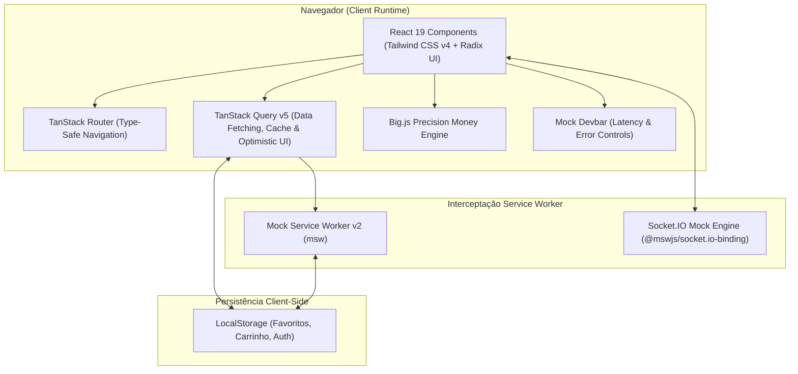
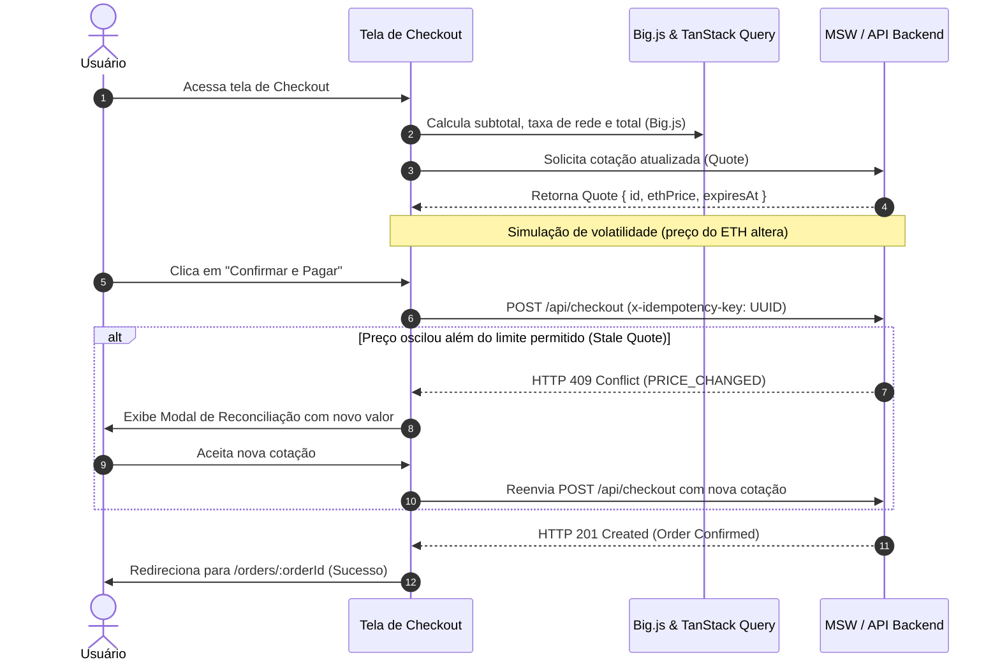
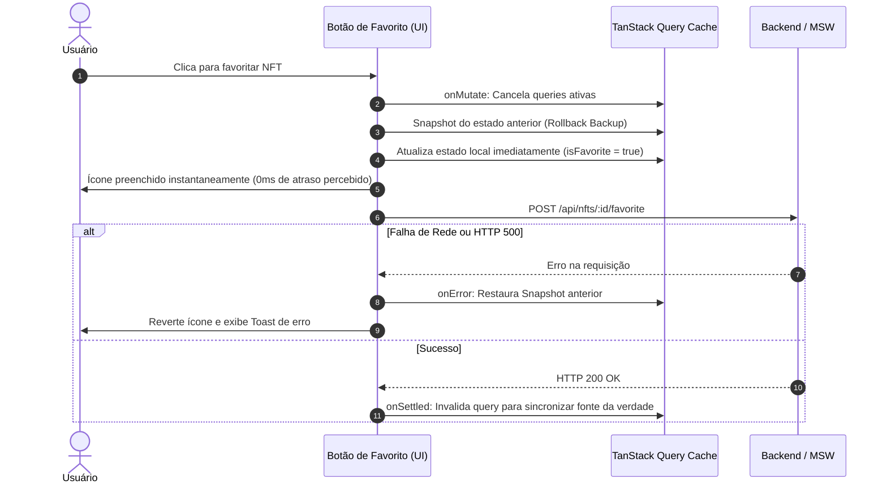

# KURIO NFT Marketplace — Diagramas de Arquitetura & Fluxos de Dados

Este documento fornece diagramas visuais prontos para apresentação na entrevista técnica, demonstrando a robustez da engenharia frontend implementada.

---

## 1. Arquitetura Geral da Aplicação

---

## 2. Fluxo de Checkout com Proteção de Cotação Expirada (Stale Quote) & Idempotência

---

## 3. Ciclo de Vida de Atualização Otimista (Optimistic Updates) em Favoritos

